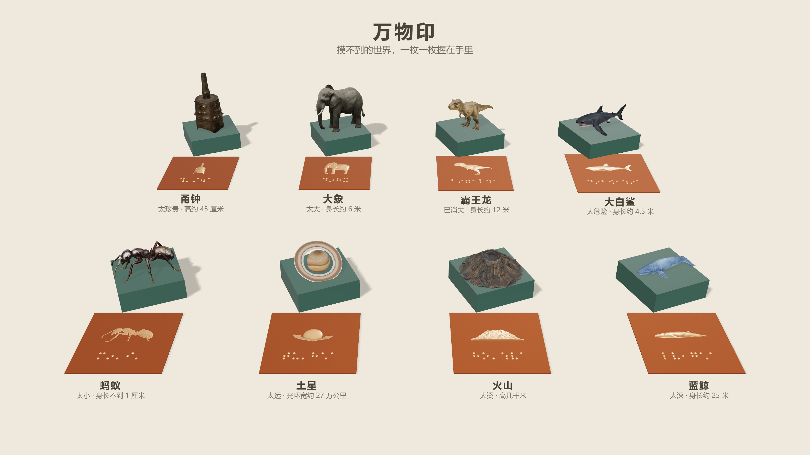

# 万物印 · Aholo 3D AI 黑客松

给盲童认识"摸不到的世界"的一套印章。印钮是 Lux3D 生成的物件：先用手摸形状，猜它是什么。印面在底下，刻着盲文名字和物件的轮廓浮雕：翻过来才有答案。在印面上铺一张铜箔拓一遍，就是一页书，孩子自己拓出一本。



[提交材料：Lux3D 能力、作品入口和实际积分](docs/Lux3D能力对照.md)

- **任务和进度**：[Linear 项目「2026.10-11 aholo 3d hackathon」](https://linear.app/youonlyattendonce/project/202610-11-aholo-3d-hackathon-8281b99b4b05)，交接说明写在项目描述里
- **概念片**（38.9 秒，无声）：[docs/media/wanwuyin_concept.mp4](docs/media/wanwuyin_concept.mp4)；每枚印的三联图也在 `docs/media/`
- **生成物快照**（`pipeline/out`：渲染、视频、Lux3D 原始输出、触摸件 STL、输入图）：Release [`snapshot-2026-11-11`](https://github.com/zicheng-yu/wanwuyin/releases/tag/snapshot-2026-11-11)
- **日期**：11/16 代码冻结，**11/17 提交**，11/19 19:00 锁队，11/19 23:59 Lux3D 积分过期，11/30 17:00 人气点赞截止

> 2026-11-11 从「万物有声」（材质 → 振动 → 声音）换到这个方向。声音降为彩蛋，旧代码和文档都保留，见文末「万物有声（扩展）」。

## 关键决定

- **只收摸不到的东西**：太大、太远、太深、太危险、已消失、太珍贵。这样"为什么要用 3D 生成，而不是给实物"有答案。
- **拓印，不盖章**：盖在黏土上的盲文是反的、凹的，摸不了；在印面上拓出来的是正的、凸的。
- **实物打印可选**：评审主要看渲染、视频和现场生成。不追求严谨，优先创意和新颖。
- **现有的图和片子只做过数值检查**（物体不出框、标签不压物体），观感还没有人审过。

## 快速开始（只看网页）

```bash
cd web
npm ci
npx vite --port 5199
```

| 地址 | 内容 |
|---|---|
| http://localhost:5199/maker.html | 造印工作台：文字 / 照片、翻面拓印、收藏、离线体验 |
| http://localhost:5199/seal.html?seal=elephant | 三联图：印钮 / 印面 / 拓出来的一页（可拖动视角） |
| http://localhost:5199/seal.html?view=set | 整套合影 |
| http://localhost:5199/seal.html?view=set&materials=1 | 同一枚大象印的青铜、玄武岩、木雕三材合影 |
| http://localhost:5199/seal.html?view=anim&seal=elephant | 12 秒动画：摸 → 翻面 → 拓印 → 成页 |

`seal=` 可换成 `web/public/seals.json` 里的名字：elephant、blue_whale、trex、shark、ant、saturn、volcano、yongzhong。

## 目录

```
web/
  seal.html, src/seal.ts   万物印：三联图 / 合影 / 动画（Vite + Three.js）
  public/seals.json        印的清单：名字、盲文、为什么摸不到、真实尺寸、模型路径、侧面朝向 yaw
  public/objects/          模型（Lux3D 生成的 GLB）和万物有声的模态数据（modes.bin）
  tools/                   出图、出片、构图检查（playwright-core + 本机 Chrome + ffmpeg）
  index.html, listen.html  万物有声：叩物沙盒、听触页
pipeline/                  Python：Lux3D 接入、触摸件与盲文、体素有限元、声音合成
  wwys/lux3d.py            Lux3D OpenAPI（余额 / 报价 / 上传 / 创建 / 轮询 / 下载）
  wwys/tactile.py          触摸件：加厚、平滑、减面、盲文底座（国家通用盲文）
  wwys/fem.py              体素六面体有限元 + 壁厚归一化（CHOLMOD 求解）
  scripts/                 lux3d_generate、seal_meta、make_tactile、textbook_to_tactile、build_demo …
  out/                     生成物（不进 git，快照在 Release 里）
docs/                      旧方向的方案、课本插图子方向、打印清单；media/ 是图和片子
```

## 环境

```bash
# 网页
cd web && npm ci

# Python（在 pipeline/ 下）
cd pipeline
uv venv .venv --python 3.12
uv pip install --python .venv/bin/python -r requirements.txt
brew install liblouis        # 盲文（zhcn-cbs.ctb = 国家通用盲文）；Linux: apt install liblouis-bin
printf 'LUX3D_REGION=cn\nLUX3D_CN_API_KEY=<你的 key>\n' > .env   # 不要提交；key 找 zicheng 私下要
.venv/bin/python scripts/selftest.py                           # 快速自检（不调 Lux3D、不做大计算）

# 可选：有限元提速（只有万物有声用得到），没有就退回 SuperLU（慢 5 倍以上）
brew install suite-sparse
SUITESPARSE_INCLUDE_DIR=$(brew --prefix suite-sparse)/include/suitesparse \
SUITESPARSE_LIBRARY_DIR=$(brew --prefix suite-sparse)/lib \
  uv pip install --python .venv/bin/python scikit-sparse
```

生成物快照（需要 [gh](https://cli.github.com/) 和仓库权限）：

```bash
gh release download snapshot-2026-11-11 --repo zicheng-yu/wanwuyin --dir /tmp/wanwuyin-snap
tar -xf  /tmp/wanwuyin-snap/pipeline-out-lux3d.tar   -C pipeline   # out/lux3d：Lux3D 原始输出
tar -xzf /tmp/wanwuyin-snap/pipeline-out-rest.tar.gz -C pipeline   # 其余：渲染、视频、音频、触摸件、输入图
```

## 万物印

### 造印机后端

`cd pipeline` 后运行 `.venv/bin/python scripts/serve_seals.py --port 8000`（Windows 用 `.venv\Scripts\python.exe`）。提供 `POST /api/seals` 和 `GET /api/seals/<id>`，支持文字/照片生成、最多 5 个任务、持久队列与预算、重启恢复；Vite 已代理 `/api`。新印写入独立的 `generated.json`。

接口、单命令生成、Windows 盲文工具和恢复说明见 [docs/造印机后端.md](docs/造印机后端.md)。页面、缓存与断网准备见 [docs/造印机使用.md](docs/造印机使用.md)。后端测试：`python -m unittest discover -s pipeline/tests -v`；前端测试在 `web/` 下执行 `npm run test:maker`，浏览器回归用 `npm run check:maker`。本轮先完成开发，不录视频。

### 加一枚印、换一个模型

```bash
cd pipeline
# 文生 3D：13 积分、3–4 分钟。图生 3D 用 --image ref.jpg：1 积分、不到 1 分钟
# 同时最多 5 个生成任务，多了会被拒（不扣费）；中断后加 --resume 续跑，不会重复扣费
.venv/bin/python scripts/lux3d_generate.py --prompt "一只站立的长颈鹿，写实风格，完整全身，白色背景" \
    --max-credits 15 --out out/lux3d/giraffe
# 拷进网页、算盲文和侧面朝向、写进 seals.json（新印要给 --why 和 --real）
.venv/bin/python scripts/seal_meta.py out/lux3d/giraffe/output_0.glb --label 长颈鹿 \
    --into ../web/public/seals.json --name giraffe --why 太高 --real "高约 5 米"
```

`yaw` 把模型俯视时的长轴转到正面：动物露出侧面，俯视接近圆的（钟、星球、火山）保持原样。自动算的不满意，就在网址上加 `&yaw=1.57` 试，满意了写进 `seals.json`。

### 出图和出片（在 `web/` 下，先开着 vite）

```bash
node tools/shot.mjs "http://localhost:5199/seal.html?view=set" ../pipeline/out/screens/seal_set.png
node tools/record.mjs "http://localhost:5199/seal.html?view=anim&seal=elephant&capture" ../pipeline/out/video/seal_elephant.mp4
# 只录片段：最后一个参数是时间段；&plain 把字幕换成"名字｜为什么摸不到"
node tools/record.mjs "http://localhost:5199/seal.html?view=anim&seal=trex&capture&plain" \
    ../pipeline/out/video/cut_trex.mp4 30 1920 1080 0.5-2.1,10.2-11.8
# 构图检查：动画几个时刻里印和拓片在画面中的位置，出框或压字幕会标出来
node tools/boxes.mjs elephant shark yongzhong trex
```

- 脚本用本机 Chrome；Windows / Linux 先设 `CHROME_PATH`。`record.mjs` 需要 `ffmpeg`。
- `&capture` 模式下页面不自己动，由脚本调用 `window.seek(t)` 逐帧渲染，录出来不掉帧。
- `shot.mjs`、`record.mjs` 会打印各物体在画面里的位置（`window.boxes()`），不看图也能查构图。

## 万物有声（扩展）

方案：[docs/方案-万物有声.md](docs/方案-万物有声.md) · 子方向：[docs/子方向-课本插图转触摸件.md](docs/子方向-课本插图转触摸件.md) · 打印：[docs/打印清单.md](docs/打印清单.md)

### 常用命令（在 pipeline/ 下）

```bash
.venv/bin/python scripts/selftest.py                           # 快速自检（不调 Lux3D、不做大计算）
.venv/bin/python scripts/validate_bar.py                       # 有限元对照解析解

# Lux3D：先报价再生成，--max-credits 设上限；中断后 --resume 续跑，不会重复扣费
.venv/bin/python scripts/lux3d_generate.py --prompt "一只白色瓷碗" --out out/lux3d/bowl
.venv/bin/python scripts/lux3d_generate.py --image photo.jpg --max-credits 5 --out out/lux3d/xxx

# 生成物体 → 模态 → WAV + 网页数据；--strike 名字=位置，可重复（rim/lip/end/zhenggu/cegu）
.venv/bin/python scripts/build_demo.py                         # 程序生成的碗/钟/杯/金属条
.venv/bin/python scripts/build_demo.py --glb out/lux3d/yongzhong/output_0.glb --name yongzhong \
    --label "甬钟（Lux3D 图生）" --material bronze --size 0.45 --wall-mm 8 \
    --strike 正鼓=zhenggu --strike 侧鼓=cegu

# 材质重绘（Lux3D material-transfer，约 19 积分）：几何不变，网页里作为"外观"切换，复用振型
.venv/bin/python scripts/lux3d_generate.py --repaint out/lux3d/bowl/output_0.glb \
    --material-img out/inputs/material_refs/bronze_patina.jpg --max-credits 20 --out out/lux3d/bowl_bronze

# 材质识别：自动规则 + 视觉复核（复核结果写 material.json，build_demo --material auto 优先用它）
.venv/bin/python scripts/material_review.py sheet out/lux3d/yongzhong --source 源图.jpg   # 看 review.png
.venv/bin/python scripts/material_review.py set   out/lux3d/yongzhong bronze --note "…"
.venv/bin/python scripts/build_demo.py --glb out/lux3d/bowl/output_0.glb --name lux_bowl --label "瓷碗（Lux3D 文生）" \
    --material auto --size 0.15 --wall-mm 3 --strike 碗沿=rim --variant "青铜（Lux3D 重绘）=out/lux3d/bowl_bronze/output_0.glb"

# 触摸件（数字请写成汉字，数字盲文规则待确认）
.venv/bin/python scripts/make_tactile.py out/lux3d/yongzhong/output_0.glb --title 甬钟 \
    --line 实物高约四十五厘米 --size 120 --out out/tactile/yongzhong
# 部件编号：先看自动分割提议，再归并命名（编号压在模型正面，名称在图例卡上）
.venv/bin/python scripts/make_tactile.py out/lux3d/yongzhong/output_0.glb --title 甬钟 --size 120 --parts-review --out out/tactile/yongzhong
.venv/bin/python scripts/make_tactile.py out/lux3d/yongzhong/output_0.glb --title 甬钟 --line 实物高约四十五厘米 \
    --size 120 --parts "1-2=甬;3-4=旋;5=枚;6=钟体" --out out/tactile/yongzhong

# 课本插图 → 触摸件：先解析出干净的物体图，用它跑 Lux3D 图生 3D，再带 --glb 跑全流程
.venv/bin/python scripts/make_textbook_figure.py white                    # 测试插图（白底）
xcrun swiftc -O tools/ocr.swift -o tools/ocr                              # 本地 OCR（macOS Vision），编译一次
.venv/bin/python scripts/textbook_to_tactile.py out/inputs/textbook/yongzhong_white_figure.png --out out/tactile/textbook_white
.venv/bin/python scripts/lux3d_generate.py --image out/tactile/textbook_white/clean.png --max-credits 3 --out out/lux3d/textbook_white
.venv/bin/python scripts/textbook_to_tactile.py out/inputs/textbook/yongzhong_white_figure.png \
    --glb out/lux3d/textbook_white/output_0.glb --size 120 --repeated 枚 --out out/tactile/textbook_white

# sim2real：打印校准条 → 录敲击声 → 反推打印 PLA 的刚度
.venv/bin/python scripts/calibrate_print.py make --out out/calibration
.venv/bin/python scripts/calibrate_print.py tap 录音.wav
```

### 网页

`cd web && npx vite`，然后打开 http://localhost:5173 。

- `?object=yongzhong&strike=1`：加载后自动敲一下
- `?object=yongzhong&rack=jasmine`：排成编钟架并演奏
- `?object=plate&sand=3&settle=150`：方板撒沙，驱动第 4 阶（从 0 数）；settle 先快进 150 跳（截图用）
- `?object=lux_bowl&variant=0`：显示第一个 Lux3D 材质重绘版本
- `listen.html?object=yongzhong`：听触页（触摸件底座 NFC 指向这里）
