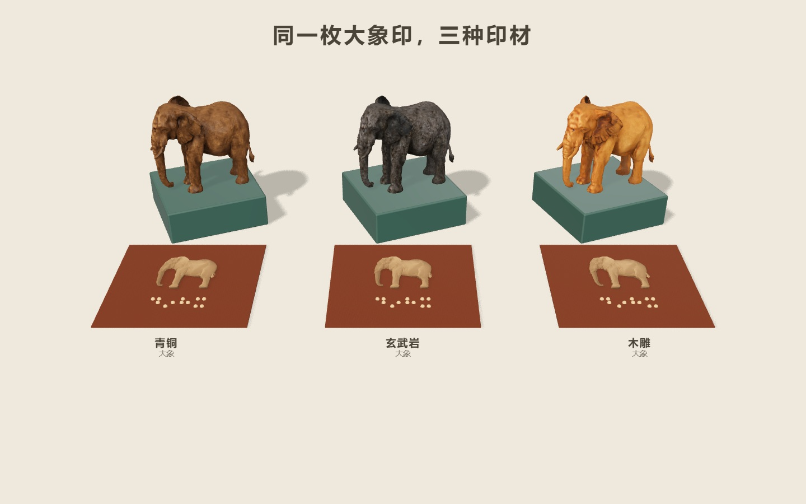
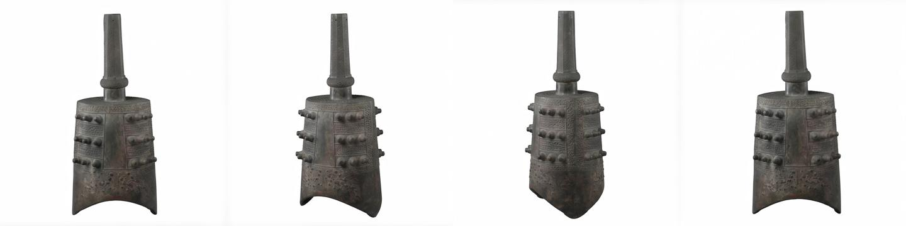

# 万物印用到的 Lux3D 能力

| 能力 | 在作品里做什么 | 已完成任务的积分 |
|---|---|---|
| 文生 3D | 把“我想摸摸……”变成印钮。精选大象来自任务 6378506，工作台也支持现场生成。 | 大象 13 积分 |
| 单图生 3D | 从一张玩具或馆藏照片造印。精选甬钟来自任务 4523886，工作台的照片上传使用同一类接口。 | 甬钟 1 积分 |
| 材质重绘 | 给同一个大象模型分别换上青铜、玄武岩和木雕外观。工作台可切换、翻面、拓印并收藏所选版本，三枚也能并排看。 | 每版 7 积分，三版共 21 积分 |
| 单图生成四视图 | 用馆藏甬钟照片补出四个角度，在工作台“带一张照片”下展开示例即可对照。补出的角度是生成结果。 | 任务 4527847，24 积分 |
| 多视图生 3D | 用上述四张图重建一枚甬钟，点示例按钮可以查看和拓印。常规上传一张照片仍走单图生成。 | 任务 4527961，1 积分 |

积分取自各任务实际报价。本次新增三次材质重绘，共 21 积分。切换印材、查看合影或打开四视图示例均读取已有资产。四视图与重建模型取自[项目生成快照](https://github.com/zicheng-yu/wanwuyin/releases/tag/snapshot-2026-11-11)。

从 `maker.html` 选择大象，在“换印材”中切换，或打开 `seal.html?view=set&materials=1` 并排比较。三版各有 7,487 个顶点和 9,556 个三角面，与原始大象的位置和索引逐项相同，因此可沿用同一盲文和朝向。展台保留重绘贴图，为青铜和玄武岩调整了 glTF 底色与反光系数。青铜重绘任务为 6447867，玄武岩为 6447866，木雕为 6447868，均使用 `v3.0-standard`。参考图来自项目留存的青铜锈、玄武岩石臼和木雕根付馆藏素材，木雕藏品编号为 MET 10.211.2034。

