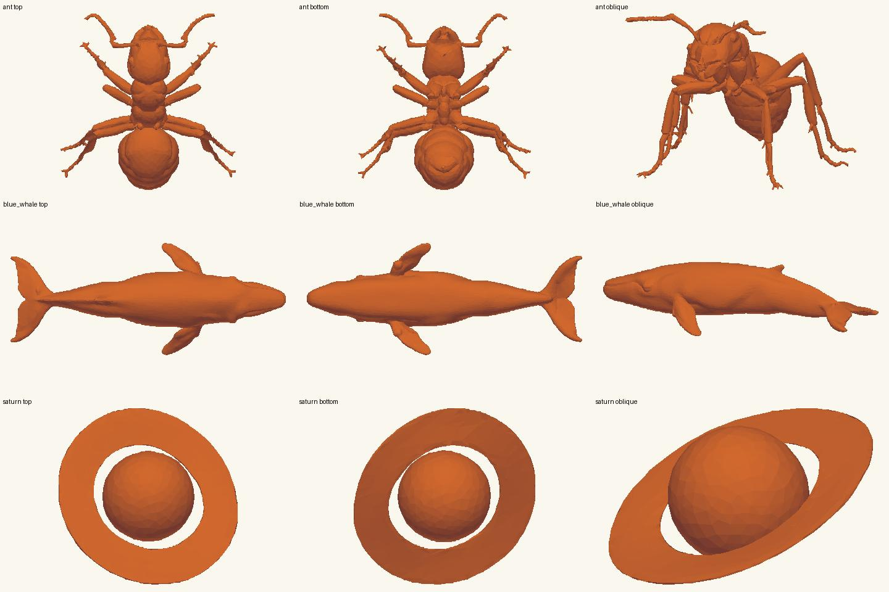

# 八枚印的渲染与概念片审阅 · YOU-190

**保留 7 枚，返工蚂蚁 1 枚，暂不换物件。** 蓝鲸、土星和火山的印钮保留，优先调整它们在印面上的投影。模型交接 [YOU-195](https://linear.app/youonlyattendonce/issue/YOU-195)，观感交接 [YOU-196](https://linear.app/youonlyattendonce/issue/YOU-196)。

审阅基线：`816c16f`。逐枚对照 [三联图](media/)、[合影](media/seal_set.png) 和 [已有 38.9 秒概念片](media/wanwuyin_concept.mp4) 的逐秒取帧。下图是直接从三份原始 GLB 得到的俯视、底视与斜视；统一底色便于看轮廓，不代表最终材质。

| 印 | 结论 | 看到了什么 | 下一步 / 参考 |
|---|---|---|---|
| 大象 | 保留 | 侧身象鼻向下再弯回，浅色象牙从鼻旁露出；翻面后仅看红色轮廓仍能认出象鼻。 | 用作首枚和明暗对照基准，沿用原模。 |
| 蓝鲸 | 保留 | 合影右下的鲸贴近印身；侧向拓片像细梭。原模俯视有左右胸鳍、展开的双叶尾鳍，问题主要在投影。 | 印面改试斜俯视，先让尾鳍两叶与躯干分开；不要拉高鲸身。 |
| 霸王龙 | 保留 | 大头、短前肢、两条承重后腿和长尾在印钮侧面很清楚；正面快切时长尾藏在身后。 | 沿用原模，快切从三分之二侧面开始。 |
| 大白鲨 | 保留 | 背鳍突出，尾鳍上下分叉；在朱砂印面上也能和鲸的身形区分。 | 沿用原模及侧向印面，作为水生动物对照。 |
| 蚂蚁 | **返工** | 两根触角可辨。俯视时中段两侧各有一截短突，后方细足贴叠并分叉；侧面印纹更难从胸部逐条追到足尖。现有证据不足以断言缺腿，但不适合教孩子数六足。 | 新 prompt：单只写实工蚁，头胸腹分明、细腰；三对足均从胸部长出，前足向前、中足向两侧、后足向后，六个足尖彼此分开；头部两根弯折触角，完整全身，白底，无底座。 |
| 土星 | 保留 | 彩色印钮和原模俯视均见闭合环和环内空隙；正对朱砂面却像圆球坐在弯托上，拓片也丢掉了环孔。 | 单独调**浮雕投影**的倾角，使球左右各留一块可见空隙；不重生成环。 |
| 火山 | 保留 | 印钮斜上方能看到暗色火山口和向下的沟壑；合影里山体矮，印面侧影像普通山丘。 | 保留低宽山体，试略带俯角的投影、用侧光读坑缘。 |
| 甬钟 | 保留 | 长柄、钟体和下缘凹口可辨；印钮上的成排突起在红色正面和小拓片上几乎看不到。 | 保留现有大都会博物馆 CC0 照片生成的模型，以原三联图钟钮为参照，给拓片钟身单独做侧光近景。 |

## 观感与镜头交接

1. **先修印面的辨形。** 蓝鲸试斜俯视，土星要能看见环孔，火山要同时看见坑缘与山坡。先并排看“印钮 / 正对印面 / 立起的一页”，三者都能认出再定角度。不要只转整台相机：那不能恢复压扁时已消失的轮廓。
2. **铜箔与盲文。** 约 7 秒铜色底上的象和点阵尚可分辨，约 10–12 秒成页后整面泛橙亮光，点与底色趋同。先压正面高光、加掠射光保住点侧阴影，再决定是否加高浮雕。用同一组点在翻面、立页和合影三处对照；合影负责看布局，读点要给近景。这是画面验收，不能替代实体触读。
3. **三种材料。** 保留深绿印身作稳定参照。侧面大块平绿像方盒，可略柔化棱边；朱砂在印面上像同色平涂，先让侧壁显影。铜箔保留反光，但避免浮雕亮成白块；一次只改一个参数，拿大象作前后对照。
4. **镜头节奏。** 0–2.6 秒转身可以交代形体；2.4–3.8 秒翻转后，给正对印面的一拍读名字，再让约 5.2 秒的铜箔落下。6.2–8.2 秒深色圆形工具滑动时，应让浮雕随接触逐步显出。8.5–9.9 秒立页后保留“印和页”同框。七段短展示中先选辨识度最高的角度，避免霸王龙正面、蓝鲸贴底的画面占掉主要停留时间。
5. **措辞与片尾。** 保留“这一页，是孩子自己做的”。把“翻过来，答案在底下”改为可操作的“翻到印底，摸摸凸点”；大象镜头可拆成“摸到长鼻子了吗？”和揭晓后的“这几个凸点写着：大象”。合影先读物名，把“已消失”改作“已经灭绝”，甬钟的“太珍贵”可改“隔着展柜”；保留其下尺寸作尺度参照。缩到手机宽度检查，片尾不要求观众一次读完八条尺寸。

## 候补物件

候补建议：**月球**（太远；用几个宽浅环形山体现触摸特征），**三叶虫化石**（已经灭绝；靠分节背甲辨形）。本轮不换物件；若蚂蚁新版本在印面上仍不能逐足辨认，再考虑以三叶虫替位。候补不计入本次生成清单。
